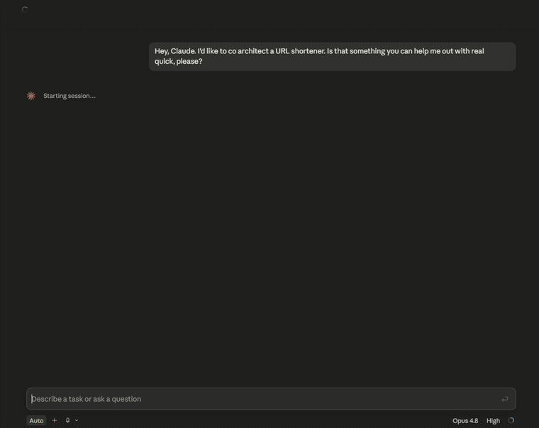

# Co-Architect

**Conversational Pair Architecture for Claude Code**

A Claude Code skill that turns software design into a structured, one-decision-at-a-time dialogue between you and Claude. Instead of getting a wall of architecture back, you work through each design decision collaboratively — with recommendations, tradeoffs, and locked principles you can resume from any device.

<p align="center">
  
</p>
<p align="center"><sub>A real session (sped up) — Claude asks one scoping question, then drives the design one locked decision at a time.</sub></p>

> **Does it actually work?** We ran two small A/B studies (CPA vs. a one-shot
> "give me the architecture" prompt). The dialogue produced smaller, better-owned
> artifacts, caught real errors the one-shot missed, and was ~7–10× cheaper to
> resume. Honest numbers and caveats in **[docs/evidence.md](docs/evidence.md)**.

---

## Why This Exists

Most AI architecture conversations go one of two ways: you get a massive plan you didn't ask for, or you go back and forth in an unstructured chat that loses context. Co-Architect fixes both problems.

It enforces a **per-decision loop** — Claude narrows to one decision, leads with a recommendation and the practical tradeoff, and waits for you to approve, modify, or challenge. Each approved decision gets locked as a **canonical principle** and recorded in a living session file. No implementation happens until the full design is complete and authorized.

The result: a spec that reflects your actual judgment, not Claude's best guess at what you wanted.

## How It Works

```
You: "Let's co-architect a notification system for my app."

Claude: "What are we designing, and where does it live?"

You: "Push notifications + in-app. It's for my SaaS product."

Claude: Decision 1 — Delivery architecture.
        Recommends: event-driven with a queue.
        Tradeoff: more infrastructure vs. reliability at scale.

You: "Approved."

Claude: Decision 1 locked.
        Principle: "All notifications flow through an async event
        bus; no direct send calls from business logic."
        → recorded in session file
        → advancing to Decision 2...
```

Each session produces a **living file** — a Markdown document that accumulates your locked decisions, the evolving spec, audit results, and a clear resume point. Pick it up tomorrow, pick it up from your phone, pick it up next week. The context is in the file, not the chat.

### The Per-Decision Loop

```
┌─────────────────────────────────────────┐
│  1. Narrow to ONE decision              │
│  2. Recommend + tradeoff                │
│  3. You: approve / modify / challenge   │
│  4. Lock as canonical principle         │
│  5. Record in living session file       │
│  6. Advance to next decision            │
└──────────────┬──────────────────────────┘
               │
         Every ~5 decisions
               │
               ▼
┌─────────────────────────────────────────┐
│  Design Audit                           │
│  • Contradictions?                      │
│  • Missing owners?                      │
│  • Hidden assumptions?                  │
│  • Unsafe defaults?                     │
│  • Unhandled failure states?            │
└─────────────────────────────────────────┘
```

### The Hard Launch Gate

Co-Architect will not generate implementation code. The design must be complete, converted to a plan, and explicitly authorized before any code gets written. This prevents the common failure mode of building half a system before the design is settled.

## Installation

### Quick Start

1. Clone this repo:
   ```bash
   git clone https://github.com/kyushocrazy/conversational-pair-architecture.git
   ```

2. Copy the skill into your project's Claude Code skills directory:
   ```bash
   mkdir -p your-project/.claude/skills
   cp -r conversational-pair-architecture/skill your-project/.claude/skills/co-architect
   ```

3. Create a sessions directory in your project:
   ```bash
   mkdir -p your-project/sessions
   ```

4. Start a session:
   ```
   /co-architect
   ```

### Global Installation (All Projects)

To make Co-Architect available across all your projects, symlink it into your user-level Claude Code config:

```bash
# macOS / Linux
mkdir -p ~/.claude/skills
ln -s /path/to/conversational-pair-architecture/skill ~/.claude/skills/co-architect

# Windows (PowerShell, run as admin)
New-Item -ItemType Junction -Path "$env:USERPROFILE\.claude\skills\co-architect" -Target "C:\path\to\conversational-pair-architecture\skill"
```

### Configuration

After installation, edit `references/homes.json` in the skill directory to register where your projects live. See [Configuration Guide](docs/configuration.md) for details.

## Usage

### Start a New Session

Type `/co-architect` or say "let's co-architect" followed by what you want to design:

```
/co-architect a REST API for inventory management
```

Claude will ask a single clarifying question, create a living session file, and begin the per-decision loop.

### Resume a Session

Type `/co-architect` with no arguments. Claude will list your open sessions and ask which one to resume. It reads the living file, announces the last locked decision and the next open question, and picks up right where you left off.

### During a Session

- **Approve** a recommendation to lock it and move on
- **Modify** — suggest a change and Claude will adjust the recommendation
- **Challenge** — push back and Claude will present alternatives
- **Tangent** — ask a side question anytime; Claude will answer and return to the open decision
- **Audit** — request a design audit at any point (automatic every ~5 decisions)

### Completion

When the design is fully locked, Claude will:
1. Mark the session file as complete
2. Fill the Handoff section with routing info
3. Offer to generate an implementation plan

## What a Session File Looks Like

```markdown
---
title: Inventory API Design
slug: inventory-api-design
destination: my-saas-app
status: active
created: 2025-01-15
updated: 2025-01-15
---

## Intent
Design a REST API for inventory management supporting
multi-warehouse tracking and real-time stock updates.

## Decisions Locked
1. Resource model — **Principle:** "Inventory is modeled as
   three resources: Warehouse, Product, and StockLevel.
   StockLevel is the join with quantity and location."

2. Stock mutations — **Principle:** "All quantity changes go
   through a StockTransaction endpoint, never direct PUT to
   StockLevel. Every mutation is an auditable event."

## ▶ Next Decision
Concurrency strategy for simultaneous stock updates
from multiple warehouses.

## Current Spec (living)
...

## Audit Log
- 2025-01-15: 5-decision audit passed. No contradictions.
  Noted: need to decide on auth strategy before API surface
  is finalized.

## Handoff
<pending — design in progress>
```

## Key Design Principles

| Principle | Why |
|-----------|-----|
| **One decision per turn** | Prevents context overload; keeps mobile-friendly |
| **Recommendation-first** | Claude leads with an opinion so you have something concrete to react to |
| **Canonical principles** | Each decision becomes a named, quotable rule — not just "we decided X" |
| **Living file** | Session state lives in a file, not in chat history — survives context limits and device switches |
| **Hard launch gate** | No premature implementation; design completes before code begins |
| **Periodic audits** | Built-in consistency checks catch contradictions early |

## Cross-Device Resume

Co-Architect sessions are plain Markdown files tracked in git. If you commit and push from one device, you can resume from another. The skill reads the session index to find open sessions and picks up from the `▶ Next Decision` marker.

This works particularly well for mobile-to-desktop workflows — start a design session from your phone during a commute, then continue from your desktop when you sit down.

## Project Structure

```
conversational-pair-architecture/
├── skill/                          # The Claude Code skill
│   ├── SKILL.md                    # Skill definition
│   └── references/
│       ├── interaction-contract.md # The dialogue discipline
│       ├── session-template.md     # Template for new sessions
│       ├── index-template.md       # Template for session index
│       └── homes.json.example      # Project registry example
├── examples/
│   └── sample-session.md           # A complete example session
├── docs/
│   ├── how-it-works.md             # Deep dive on the methodology
│   ├── configuration.md            # Configuration guide
│   ├── evidence.md                 # A/B study: CPA vs. one-shot
│   └── demo.gif                    # README demo
├── LICENSE
├── CONTRIBUTING.md
└── README.md
```

## Contributing

Contributions are welcome. See [CONTRIBUTING.md](CONTRIBUTING.md) for guidelines.

## License

MIT — see [LICENSE](LICENSE) for details.

## Credits

Co-Architect was developed as a [Claude Code](https://docs.anthropic.com/en/docs/claude-code) skill. It encodes a design methodology refined through real-world use across construction tech, SaaS, and developer tooling projects.
